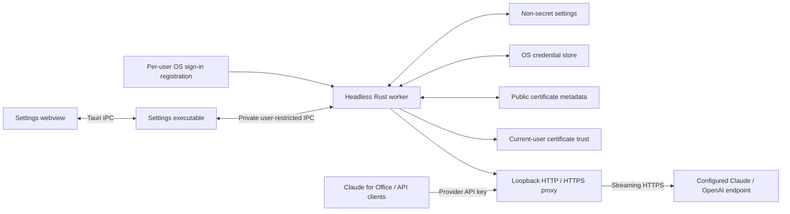

# ICA proxy Architecture

Status: MVP implemented; cross-platform release and memory gates pending

Date: November 19, 2026

Requirements: [REQUIREMENTS.md](REQUIREMENTS.md)

## 1. Recommended framework

Use **Tauri 2 + Rust for the desktop application and proxy, with Svelte + TypeScript for the settings GUI**.

Tauri uses the operating system's webview: WKWebView on macOS and WebView2 on Windows. It hosts the settings application only. A separate **headless Rust worker** runs continuously; it has no Tauri, webview, Dock icon, tray icon, or frontend runtime dependency. [S1, S3]

Closing or quitting settings exits its process. The proxy keeps running in the independently launched worker. Automatic sign-in startup launches only that worker, so no native reopen event can create settings during a normal worker startup.

This is a recommendation based on the framework's architecture, not a measured RAM guarantee. Release builds must demonstrate background usage strictly below 200 MB across all app processes, ideally below 100 MB, on every supported architecture before the stack is accepted for release.

### Alternatives considered

| Option | Relevant tradeoff | Decision |
| --- | --- | --- |
| Tauri 2 + Rust | Uses the OS webview, provides Rust integration, and supports the required desktop lifecycle. Requires maintaining Rust and TypeScript code. [S1-S4] | Recommended; validate memory behavior first. |
| Wails + Go | Also combines a compiled backend with the OS webview. A reasonable alternative if Go becomes the team's preferred language. Its memory and lifecycle behavior would need the same validation. [S5] | Viable alternative; no evidence here that it uses less memory. |
| Electron + TypeScript | Bundles Chromium and Node.js. That adds a runtime distribution cost that is a weaker fit for this application's small installer and background resource priorities. [S6] | Do not select for the MVP. |

The implementation uses stable Tauri 2 with compatible plugins and committed Cargo/npm lockfiles. Rust is pinned in `rust-toolchain.toml`; dependency changes must preserve those locks.

## 2. Technology choices

| Layer | Proposed technology | Responsibility |
| --- | --- | --- |
| Settings host | Tauri 2 / Rust | Settings lifecycle, native menus, GUI commands, worker registration and launch. |
| Settings GUI | Svelte + TypeScript + Vite | Provider setup, connection tests, status, background startup status, diagnostics. |
| Local HTTP/HTTPS server | Axum routing + Hyper transport; Tokio Rustls for inbound TLS | Shared routing/authentication, bounded HTTP/1.1 and HTTP/2 connections, incremental streams. |
| Local certificate generation | rcgen with Ring | Unique per-installation P-256 CA/server identity; loopback-only SANs and CA name constraints. |
| Certificate trust | Platform adapter + Rustls/native root verification | Explicit current-user trust, status checks, renewal/removal through the GUI. |
| Async execution | Independent Tokio runtime in each executable, two networking threads each | Worker networking/cancellation; separate GUI IPC. |
| Upstream HTTP client | Reqwest with Rustls | TLS, connection reuse, request and response streaming. |
| Credential storage | `keyring-core` with native platform stores | macOS Keychain and Windows Credential Manager. |
| Non-secret settings | Serde + versioned JSON files | Endpoints, HTTP/HTTPS ports, preferences; public certificate chain and expiration stored separately. |
| Operational diagnostics | Bounded, sanitized in-memory ring | Up to 64 lifecycle and error events; no request content or disk logs. |
| Startup integration | macOS SMAppService LaunchAgent; Windows Task Scheduler logon task | Automatically register the worker once per user; respect subsequent OS opt-outs. |
| Instance control | Tauri single-instance plugin for settings; OS lock/first named-pipe instance for worker | One settings instance and one worker per user. |

Svelte compiles UI components into JavaScript; use a small static frontend without a separate production web server. Axum is built around Tokio/Hyper and Tower middleware. Reqwest exposes streamed response bodies and configurable network policies. [S7-S9]

The credential implementation should depend on `keyring-core` and only the Apple/Windows native stores required by the build. The current keyring project recommends selecting stores explicitly instead of pulling in its general-purpose CLI dependencies. Never use its sample or mock store in production. [S10]

Node.js and npm are build tools for developers and CI. End users install a packaged application and do not install a JavaScript runtime, Rust toolchain, or CLI.

## 3. Runtime and component boundaries



`llm-proxy` is the settings executable. `llm-proxy-worker` owns all proxy listeners, settings writes, provider clients, native credential operations, public HTTPS metadata, trust operations, and the bounded diagnostics ring. `crates/proxy-service` contains the independent controller and worker IPC; `crates/proxy-core` remains the transport/routing library. Tauri links the shared DTO/client code but does not construct a second controller or credential store.

The displayed app name is **ICA proxy**, set through Tauri product metadata and the settings/window/menu labels. The MIT license is included as a bundle resource and in the source repository. Keep `app.llmproxy.desktop`, credential service/account names, executable filenames, private IPC addresses, LaunchAgent labels, and scheduled-task names stable across this rename so existing settings, secrets, and background registration can be reused. Newly generated HTTPS certificates use the ICA proxy name; saved certificate identities are retained until explicit renewal or removal. Published releases keep their original asset names and versioned documentation.

| Component | Owns |
| --- | --- |
| Worker `AppController` | Serialized settings/lifecycle operations and authoritative proxy state. |
| Settings `AppController` | Typed IPC adapter, startup status, connection recovery, sanitized status events. |
| `RunningProxy` | Loopback listeners, bounded connections, API-key auth, routing, streams, cancellation. |
| `CredentialStore` | Native provider keys and HTTPS key; serialized blocking operations. |
| `CertificateStore` / platform adapter | Identity creation, validation, current-user trust, renewal and removal. |
| `SettingsStore` | Validated JSON migration and atomic persistence. |
| `startup` | OS worker registration, migration of the old GUI login item, upgrade fingerprint and uninstall. |
| `transport` / `ipc` | User-restricted management channel, singleton enforcement, versioned bounded messages. |

## 4. GUI communication and state

The GUI calls a narrow set of typed Tauri commands, such as `get_status`, `save_provider`, `delete_provider`, `test_connection`, `start_proxy`, `stop_proxy`. The settings host forwards typed requests to the worker; the worker validates inputs and emits status-change events. Do not poll continuously or publish prompts and streamed response chunks into the UI.

The worker management channel is separate from HTTP/HTTPS API listeners:

- macOS uses a Unix socket in `/tmp/llmproxy-<uid>/`: owner-only directory (0700), socket and lock file (0600), ownership/symlink checks, and same-UID peer validation. An OS file lock guards stale-socket cleanup and singleton ownership.
- Windows uses `\\.\pipe\llm-proxy-<user-SID>`, a protected DACL granting only that user, non-inherited handles, rejection of remote clients, and first-instance enforcement. Clients verify the server process's user SID before sending credentials.
- Messages use protocol version 1, a four-byte length prefix, and bounded JSON (128 KiB). At most eight management connections exist, including subscriptions. Request headers/bodies and writes have finite deadlines. Calls awaiting deliberate native approval allow up to five minutes; mutating calls are never replayed after a write.
- A worker watch channel coalesces status changes; one persistent GUI subscription carries only status snapshots. The GUI serializes multi-command save/start/reset and registration sequences; the worker separately serializes authoritative settings/lifecycle operations. Disconnect releases its slot immediately, even while idle. GUI recovery uses exponential backoff capped at 32 seconds, only while settings is open. The worker does no periodic GUI polling.
- Serialized frame buffers and owned request/reply key strings are zeroized where practical. No management port, browser management endpoint, generated local token, or secrets in process arguments are introduced. Same-user native applications are within this channel's trust boundary; it does not isolate mutually hostile programs in one OS account.
- The settings host checks the running worker's startup-time executable fingerprint against the installed worker. A mismatched worker is stopped and its exit awaited before new secrets are sent. The identity also distinguishes OS-managed and manually launched workers; after OS startup becomes enabled, reconnecting settings hands a manual worker over to the OS-managed job instead of leaving duplicate launch attempts. Windows installers also wait for worker exit before replacing locked files.

HTTPS adds `set_https_port`, `setup_https`, `trust_https_certificate`, `check_https_trust`, and `remove_https`. Only the settings window is authorized. IPC carries no certificate private key and accepts no shell commands, certificate paths, trust-store names, or arbitrary certificates. Status includes whether HTTPS is enabled, its port, certificate configuration/trust, expiration, SHA-256 root fingerprint, and each provider's optional HTTPS base URL. Certificate setup/renewal, removal, and port changes require a stopped proxy. Trust changes are deliberate GUI actions with confirmation; the native OS may show its own authorization dialog. No new shell or filesystem permission is exposed to the webview.

Provider keys entered in the GUI move directly through IPC to the credential store. Ordinary settings/status responses contain only a `has_key` flag. Revealing or copying a stored secret requires a deliberate user action; clear transient secret fields when the view closes. Never persist secrets in webview storage.

Load only bundled UI assets, prevent navigation to remote content, apply a restrictive content security policy, and grant capabilities only to the settings window. Do not expose generic shell execution or arbitrary filesystem access. Tauri's capability system is the basis for constraining IPC/plugin access; custom commands must also validate inputs and authorization. [S11]

Track the server lifecycle separately from provider readiness: the server can be running while a provider is unconfigured, has a locked credential, or last failed a connection test. Provider errors must not take the other provider offline.

## 5. Local API contract and forwarding

### Addresses and supported surfaces

Use HTTP port **8787**, editable in the GUI, plus optional HTTPS port **8788**. Both bind explicitly to `127.0.0.1` and, where available, `::1`. HTTP URLs use `127.0.0.1`; HTTPS URLs use `localhost`, which is covered by the certificate along with both loopback IPs. Never bind a wildcard interface or silently choose another port. HTTPS uses a separate port so existing HTTP clients keep working without protocol sniffing, redirects, or URL changes. Both active ports must be distinct and must be excluded as upstream destinations.

Use separate provider namespaces. These examples specify the intended mapping, including the version prefix:

| Provider | Saved upstream base | Local client base | Example forwarding |
| --- | --- | --- | --- |
| OpenAI | `https://api.servicesessentials.ibm.com/v1` | `http://127.0.0.1:8787/openai/v1` | `/openai/v1/responses` becomes upstream `/v1/responses`. |
| Claude | `https://api.servicesessentials.ibm.com` | `http://127.0.0.1:8787/claude` | `/claude/v1/messages` becomes upstream `/v1/messages`. |

Once HTTPS has been set up, Office uses `https://localhost:8788/claude`; OpenAI-compatible browser clients can use `https://localhost:8788/openai/v1`. Both transports share the same namespaces, upstream snapshots, provider-key authentication, CORS policy, eight-request concurrency limit, and cancellation token. There is no separate HTTPS token. The local listeners do not redirect between HTTP and HTTPS.

### Local HTTPS identity and user trust

Anthropic's Office gateway configuration calls for an HTTPS base URL and CORS for the Office origin. The app terminates TLS itself, with no reverse-proxy process, Node runtime, external certificate-generation utility, hosted relay, or development-tool prerequisite for end users. TLS 1.2/1.3 and ALPN for HTTP/1.1 and HTTP/2 use Rustls with the existing Ring provider. The settings GUI supplies the complete setup flow. [S19-S21]

1. **Set up HTTPS:** while stopped, generate a unique P-256 root and server key. The root has a path-length limit of zero and name constraints for `localhost`, `127.0.0.1/32`, and `::1/128`. The leaf has exactly those three SANs, digital-signature key usage, and server-authentication extended key usage. Backdate validity five minutes for small clock differences; the server certificate lasts 365 days and the root 3650 days.
2. **Persist the identity:** save only the public root/leaf DER and expiration in `https-identity.json`. Save the server's PKCS#8 DER key as the `https-server-key` credential through the native store; never put it in settings, temporary files, IPC, logs, or the repository. The issuing private key is discarded after the one server certificate is signed. Owned exported key buffers use `Zeroizing`; libraries/OS internals can retain transient copies. Each device generates its own identity; sharing the developer Rust bundle does not share certificates or credentials.
3. **Trust certificate:** the explicit **Set up HTTPS and trust certificate** button authorizes creation and current-user trust in one action, with no separate application confirmation for initial setup. The existing `setup_https` command retains its lifecycle-operation lock across creation, settings persistence, trust installation, and verification. Publish the newly created identity before requesting trust so a denial leaves visible, retryable state. The same button invokes the existing trust-only command when an enabled, unexpired identity is already present but untrusted; it does not regenerate that identity. On macOS, invoke `/usr/bin/security` directly with argument arrays: discover the user's default keychain and add SSL trust in the user domain, with no `sudo`, shell, or admin-domain flag. On Windows, use Crypt32 to add the certificate to the current user's `ROOT` store. These operations may require OS authorization or be blocked by management policy. Do not bypass a denial or disable client certificate validation. [S23, S24]
4. **Verify and connect:** validate the chain, SAN, lifetime, and private-key match; evaluate trust against native-loaded roots. Trust status is refreshed at launch and on explicit checks/actions, with no background polling. This verifies the local chain, not Office connectivity or its browser permissions. Restart Office after trust changes, start the proxy, and copy the HTTPS URL. The existing HTTP URLs remain available. [S22]
5. **Renew or remove:** **Renew HTTPS and trust certificate** confirms replacement while stopped, replaces both root and leaf, removes the old root's trust, and requests and verifies replacement trust in the same operation. Because the issuing key is discarded, renewal needs a new OS trust approval; the GUI shows the expiry and does not silently renew roots or prompt during login. Remove HTTPS deletes this root's trust/certificate by exact identity, deletes its private key/public metadata, and disables HTTPS. Reset/pre-uninstall performs the same cleanup before clearing provider keys and settings. Do not delete unrelated roots. If cleanup is denied, retain an actionable failure and allow retry.

New-user onboarding includes trusted HTTPS through a deliberate button action. Existing installations bypass onboarding and retain their optional HTTPS configuration. Older settings default `httpsEnabled` to false and `httpsPort` to 8788, preserving saved HTTP endpoints, keys, startup preferences, and browser-origin policy. If an existing HTTP client already uses port 8788, require a different HTTPS port when enabling it; do not invalidate the previous HTTP-only configuration.

Construct and validate the identity and bind every enabled loopback listener before spawning serving tasks. A TLS key/chain/expiry problem or any enabled-port conflict fails startup and releases all new bindings; do not silently downgrade a configured HTTPS listener. Starting at login reuses the saved certificate and private key without a webview, trust prompt, or network dependency. A locked key store or expired/missing identity requires attention in settings. Public metadata is written atomically; on a failed write, restore the previous server key, reporting a rollback failure explicitly if necessary. Removing prior trust during renewal can require re-trusting the previous identity after a failed replacement.

The native trust operation and an actual Office session still need platform acceptance tests. An HTTPS listener does not guarantee access through every Office build, local-network permission, enterprise certificate policy, or future Office origin. Preserve the editable exact-origin allowlist and document additional origins only when Anthropic publishes them.

Treat the saved upstream URL as a base, with provider-specific conventions explained in the GUI. Strip the complete local mount prefix and append the remaining relative path to the saved base, preserving its path and the incoming query string. For example, an OpenAI base ending in `/gateway/v1` must remain `/gateway/v1/responses`. Show a destination preview during setup; never guess by repeatedly adding/removing `/v1`.

Validate base URLs, reject embedded credentials and fragments, and prevent absolute request targets or path traversal from changing the configured destination. A client cannot choose a new upstream host through a URL, query parameter, or header. Reject configurations that route back into this app's own listeners.

Require certificate-validated HTTPS for remote upstreams. Permit HTTP only for explicitly configured loopback addresses; any hostname exception must remain loopback at connection time, not just during setup validation. Expose no configuration/administration HTTP endpoints and reject unsupported proxy methods such as `CONNECT`. GUI administration uses Tauri IPC.

Browser access defaults to the exact Office origin `https://pivot.claude.ai`. `BrowserOrigins` in `crates/proxy-core/src/cors.rs` validates up to 16 unique canonical HTTPS origins without paths, credentials, or wildcards. Users can edit the list in settings while stopped; an empty list disables browser access. Persist it as non-secret configuration, default older settings files to the Office origin, and preserve an explicitly empty list. Each running proxy keeps an immutable policy snapshot. Validate a single Origin header, loopback Host, namespace, header budget, and GET/POST/OPTIONS methods. Valid OPTIONS preflights return 204 without authentication, provider configuration, upstream traffic, or generation capacity. Echo validated requested header names so SDK metadata additions do not require app updates; explicitly listing Authorization avoids wildcard-header semantics. Actual API calls still authenticate against the saved provider key. Add local CORS headers to successes and all errors for an approved origin, preserve Vary, and expose returned header names for request IDs and rate-limit metadata. Strip browser Origin/Referer and CORS request headers before forwarding; discard all upstream CORS policy headers. Cookie-based browser credentials are not enabled. Unlisted origins remain rejected, including other Claude subdomains by default. Native clients without Origin retain their existing API behavior.

This CORS policy applies equally to HTTP and HTTPS. Users can add future documented origins through the GUI without a release. Broad subdomain trust would not cover a move to a different domain, path/protocol changes, or browser transport restrictions. A real Office smoke test remains required before claiming end-to-end Office support.

Proposed compatibility coverage is Claude Messages and model listing, plus OpenAI Responses, Chat Completions, and model listing over HTTP, including applicable SSE streams. Other ordinary HTTP routes can pass through the same forwarding machinery but are unverified until added to the compatibility matrix. WebSockets, Realtime sessions, and large-file transfer support require separate scope decisions.

### Request pipeline

1. Validate browser origin, local Host, namespace, and header limits. Answer approved browser preflights locally; enforce actual-request concurrency before forwarding bodies.
2. Select the provider from the namespace and snapshot its configuration and credentials for this request.
3. Validate the client's credential against the API key in that provider snapshot.
4. Construct the destination under the configured upstream base.
5. Remove local credentials, unrelated provider credentials, hop-by-hop headers, and the incoming `Host`; set the correct upstream authentication.
6. Stream the body to the upstream and relay its status, relevant headers, and response body with bounded buffering.
7. Release the concurrency permit and upstream resources when the response finishes, the client disconnects, or cancellation occurs.

Use the same API key saved by the user for both local authentication and the selected provider's upstream authentication. Do not generate a separate local token. Accept the key as a Bearer token or in `x-api-key`, validate it against the selected provider snapshot, and reject missing, incorrect, duplicate, or conflicting credentials. A key saved only for Claude cannot authenticate to the OpenAI namespace, and vice versa. Key rotation atomically changes authentication and forwarding for new requests; existing streams retain their original snapshot.

OpenAI uses Bearer authentication. Claude supports Bearer credentials and an `x-api-key` compatibility mechanism, as documented by the providers. The Claude adapter should initially inject the saved key through `x-api-key` and remove any client Bearer credential. Preserve applicable version, beta, workspace, project, and organization metadata without confusing it with local authentication; workspace/project overrides can live in advanced settings when needed. [S12, S13]

Keep payloads and model identifiers opaque: no provider SDK, JSON rewriting, model list, or API translation is required in the forwarding path. Filter hop-by-hop headers in both directions, including headers named by `Connection`. Let the HTTP transport regenerate framing headers when needed.

Host validation is specific to the accepting listener's port. HTTP/1 absolute-form request targets remain forbidden. HTTP/2 uses its normal `:authority` value and rejects a conflicting Host header; accepting HTTP/2 must not create an alternate destination-selection path.

Strip upstream `Strict-Transport-Security` and `Alt-Svc` along with existing cookie/framing/CORS filters. Remote transport policy must not configure the localhost origin or advertise a remote HTTP/3 endpoint for this listener.

### Streaming and error handling

- Relay response bytes as they arrive; preserve SSE content types and event data. Do not parse and rebuild events.
- Use bounded backpressure between downstream and upstream. Avoid whole-body `.json()`, `.text()`, or `.bytes()` calls in the forwarding path.
- Configure compression explicitly so bytes and `Content-Encoding` remain consistent. Prefer opaque pass-through without automatic decompression.
- Disable redirects, cookies, and automatic request retries. Explicitly audit Reqwest's retry policy instead of assuming the client has no retries. [S8, S9]
- Proposed timeouts: 10 seconds to connect, 120 seconds to receive response headers, and 120 seconds without body progress. Do not apply a short fixed total timeout to an active stream. Tune these against real client behavior.
- Preserve upstream error status, safe headers, and body. For errors generated locally, use a small provider-shaped JSON error with a stable code and actionable message.
- Once response headers have been sent, an interrupted stream cannot become a different HTTP status. Close the stream, cancel upstream work, and record sanitized diagnostics.

## 6. Settings and credential persistence

Store non-secret JSON in the current user's platform application-data directory. Include `schema_version`, local port, legacy startup compatibility field, onboarding completion, provider base URLs, optional provider metadata, and stable credential identifiers. Do not introduce a database for this small configuration surface.

The legacy `startAtLogin` field remains readable for schema compatibility and reset; it no longer controls worker launch. `worker-startup.json`, owned by the settings host, stores only the worker fingerprint and reset marker. It is separate from worker-owned proxy settings. The serialized settings use camelCase and add `httpsEnabled`/`httpsPort` with backward-compatible defaults. `https-identity.json` is a separate versioned, size-limited public-certificate document. Validate its chain, loopback names, and expiration cryptographically before activating it; validate the key match when loading from the native store. Do not infer trust solely from a saved boolean or successful file creation.

Write through a temporary file and atomic replacement. Validate and migrate before activation; preserve the last working configuration if a save fails. Apply new provider snapshots to new requests, allowing in-flight requests to finish on their existing snapshot. Port changes require a controlled listener restart and a clear GUI status.

Store provider keys under stable application-specific names in macOS Keychain or Windows Credential Manager through the native adapters. Credential-store calls that can block must run outside async networking tasks. Locked or denied stores produce an actionable state with no plaintext fallback. Reset also removes any obsolete local-token credential left by earlier builds. [S10]

On macOS, keep using the user's login Keychain and its native application-specific approval for `llm-proxy-worker`. Moving credential access from the GUI to the worker can require a new **Always Allow** approval for existing items. Stable credential service/account identifiers and HTTPS identity are preserved; no key is copied into a new plaintext store. The settings window explains how to enter the login Keychain password in the macOS prompt and select **Always Allow**, separately for each provider credential and the HTTPS private key. The app cannot select or reliably verify this choice. It must not collect a Keychain password or broaden item access to every application. A locked Keychain still needs unlocking; updates to the current ad-hoc signed executable may require renewed approval. Stable Developer ID signing remains a release requirement, not a guarantee that a locked Keychain will be accessible. [S26]

The runtime-only `platform` status field controls visibility of macOS guidance without another plugin or persisted setting. A deliberate **Check saved-key access** action invokes `check_saved_key_access` from the authorized settings window. The controller serializes it with settings/lifecycle operations, snapshots configured provider identifiers and HTTPS enablement, then uses a blocking worker and the existing credential adapter to read and immediately drop each configured secret. Missing, locked, or denied items return sanitized errors. IPC returns only success or an error; it never returns secret values or claims persistent authorization. The check makes no network requests, changes no settings or proxy state, and adds no polling or extra approval-check task. Normal worker startup independently reads configured credentials to start the proxy. After fixing access, the user can start a previously stopped proxy explicitly.

Keep secrets out of URLs, process arguments, environment variables, config backups, and logs. Minimize in-memory copies and zeroize owned secret buffers where practical; this does not guarantee removal of every transient copy made by an OS or networking library. Deleting a provider configuration removes its credential as well.

## 7. Automatic startup and desktop lifecycle

Automatic startup means **after the user signs in following reboot**. Pre-login LaunchDaemons/Windows Services remain outside scope because the worker uses that user's unlocked Keychain/Credential Manager and certificate trust.

There is no Start at login checkbox and no resident GUI/tray host. A new installation registers the worker only at the final onboarding action. Until completion, opening settings can launch an idle manual worker for private IPC, but saved keys alone never start proxy listeners. Completed installations start saved providers at each worker process launch. A saved legacy GUI login item is removed after worker registration; the former `--background` GUI argument is accepted only for migration and never opens a window.

- **macOS 13+:** bundle `app.llmproxy.worker.plist` in `Contents/Library/LaunchAgents`; its `BundleProgram` points to `Contents/MacOS/llm-proxy-worker`. Register it through SMAppService using the signed containing app. `RunAtLoad` starts at sign-in in the Aqua user session. `KeepAlive.SuccessfulExit=false` recovers crashes with a 30-second throttle; a normal worker shutdown is not immediately restarted. System Settings background-item approval remains under OS/user control. [S27]
- **Windows:** register a unique task `llm_proxy-<user-SID>` with a per-user logon trigger, `InteractiveToken`, and `LeastPrivilege`. No account password is saved. The action is the worker executable directly, with no shell and only an internal `--managed` argument. The task permits battery operation, has no execution-time cap, and retries failures up to three times at one-minute intervals. Settings explicitly starts the registered task in the current session. [S28]
- `worker-startup.json` records verified enabled/pending-approval registration and the installed worker SHA-256. Write it only after observing one of those states; adopt an already registered service without another native registration call. Subsequent launches preserve OS-disabled registration rather than silently enabling it. When an enabled worker binary changes after onboarding, re-register the service for the new identity. On macOS, wait for the asynchronous unregister completion (with a 15-second bound on a blocking thread) before registering a replacement; the synchronous API does not wait for the old process to be reaped. While OS approval is disabled, keep the previous fingerprint so restoring approval can still refresh the changed executable. A successful reset leaves a disabled marker; the explicit final onboarding action enrolls it again; saving a provider during incomplete setup does not.
- Development mode never registers, unregisters, or migrates OS startup entries. Running an unbundled macOS release binary reports that installation is required; it does not attempt to register a nonexistent bundled agent.
- If registration fails or awaits approval, show the state and recovery guidance in settings. Opening settings can start an independent worker manually for the current sign-in; failure is never reported as successful automatic startup.
- On macOS, when authoritative service status is `RequiresApproval` (or registration explicitly reports user denial), the normal settings GUI presents **Allow background startup** once per settings session after onboarding. During onboarding, the final step owns approval guidance and the generic prompt is suppressed. **Open Login Items settings** invokes `SMAppService.openSystemSettingsLoginItems` only after a user action. **Later** dismisses it; ordinary status events never reopen it during that session. The headless sign-in worker never creates a prompt or opens System Settings. The OS retains control of approval; there is no API to force an in-app native Allow dialog. [S27, S29]
- The settings-only commands `open_startup_settings` and `check_background_startup` use the existing settings-window authorization boundary; no generic URL, shell, or additional webview permission is exposed. The check explicitly reruns initialization and obtains fresh worker status, so users can retry failed registration or confirm newly granted approval without restarting settings. It preserves the reset marker and OS-disabled enrollment. While the proxy is running, confirm the check because registration refresh or manual-to-managed worker handoff can interrupt requests. There is no timer, focus-triggered registration, or repeated background retry.
- Startup policy distinguishes `Inspect` (normal connection/provider saves), `Enroll` (final onboarding), and `Repair` (explicit Check background startup). Keep macOS `NotFound` as a recoverable internal `Missing` state, separate from `NotRegistered`/disabled. Inspection reports a missing service without attempting repair. Final onboarding or an explicit repair after onboarding may register it once even when a marker already exists; the marker is not proof that macOS can still discover the service. Recheck status after the attempt, with no retry loop. During incomplete setup, an existing enrollment remains inspectable, but only the final onboarding action may register/refresh it. Reset and existing OS-disabled enrollment are preserved by checks.
- Before native macOS status/registration, validate the containing `.app` layout, expected bundle identifier/settings executable, both executable files and their execute permissions, and the agent plist's label, bundle-relative worker path, exact managed arguments, and RunAtLoad flag. Unbundled release binaries report installation required; malformed or incomplete bundles report installation guidance before native calls. Native registration remains responsible for signature/OS authorization validation; file presence alone does not establish successful enrollment.
- After any native registration result, observe service status first: enabled or pending approval takes precedence even if the call returned an error. Otherwise retain the sanitized native failure, or report the unverified/missing state if the call returned success. Do not save a new marker or remove legacy registration on an unverified result. Classify ServiceManagement user denial, invalid signature, invalid bundle, and authorization errors separately. Match allowlisted error-domain strings rather than linking the `SMAppServiceErrorDomain` global, which requires macOS 15; retain support for macOS 13/14. Export only a known domain label and numeric code, not raw NSError descriptions or userInfo. Unknown native status values have a distinct safe numeric diagnostic. Windows retains its per-user, non-elevated Task Scheduler flow.
- The startup policy uses a small native-service adapter so tests can exercise registration attempts, ordering, and marker persistence with temporary bundles/settings and simulated OS statuses. Tests do not enroll real login items. The settings host serializes the explicit retry with initial inspection, then refreshes worker identity; an enabled state accepts only a matching managed worker, including during readiness waits after a manual-to-managed handoff.

| Event | Behavior |
| --- | --- |
| Sign in | OS launches only the worker; start saved providers only after onboarding completion; create no GUI/webview/Dock/tray. |
| Open settings | Connect to the existing worker or launch it; focus a single settings window. |
| Close window / Quit settings | Exit all settings/webview processes; leave the worker and active requests running. |
| Stop proxy | Cancel/drain proxy requests and close listeners within the existing five-second budget; worker stays available for settings. Stop lasts until Start or a later worker launch/sign-in. |
| OS disables background startup | Preserve that decision on later settings launches; display disabled/approval-required status. |
| Reset / prepare to uninstall | Stop proxy; remove HTTPS trust/private key and provider keys; reset settings; unregister worker and remove legacy GUI startup; stop remaining worker. Do credential/trust cleanup before unregistering because SMAppService can terminate the agent immediately. |
| New setup after reset | Recreate an idle worker on demand; resume the wizard; only its final action re-enrolls background startup. |
| Windows upgrade/uninstall | Internal installer hooks stop/wait for the worker; uninstall also removes the task and legacy Run entries. No CLI steps are exposed to end users. |

Registration and native approval failures stay actionable. The worker does not request new HTTPS trust at login. Locked credentials produce sanitized diagnostics; resolve them in settings and select Start. No repeated approval loop or automatic generation request is added.

### First-run onboarding

`Onboarding.svelte` presents three ordered steps using the existing Svelte UI and theme, without another framework or background task. The first step saves one provider through the existing credential/endpoint commands. The second uses the combined HTTPS setup/trust command, reuses an enabled unexpired certificate after denied trust, and refreshes native trust before advancing. The final action starts the proxy and enables per-user background startup. Optional connection tests and the second provider remain in normal settings; setup completion establishes local readiness only.

Worker-owned `settings.json` adds non-secret `onboardingComplete` to schema 1. Fresh `Settings::default()` and reset set it to false; deserializing older settings without the field defaults it to true, preserving established installations and HTTP-only choices. Ordinary status includes this flag. The frontend derives the resume step from saved provider presence and enabled/configured/trusted/unexpired HTTPS; no key or step is placed in localStorage. Input secrets clear after save, provider change, and teardown. Settings remain reachable for port conflicts or recovery, with a Resume setup action while incomplete.

Every step offers **Skip setup**. The frontend first saves a pending key or an existing provider's edited endpoint through `save_provider`, clearing the key input only after that save succeeds. It then calls the settings-window-authorized `skip_onboarding` command. A non-secret endpoint-only edit travels as an optional typed `ProviderDraft`; the worker validates it and atomically persists it in `providerDrafts` together with `onboardingSkipped=true`. Drafts are separate from configured providers, appear as editable endpoint defaults, and never imply a saved key or become forwarding upstreams. Saving a provider with a key promotes/replaces its draft through the existing credential rollback/persistence path. Skip failures retain the wizard and any unsaved input; a key saved before a later dismissal failure remains saved. Neither a secret nor a UI draft is written to browser persistence. The new settings fields default to false/empty for existing files; reset clears both.

Skipped onboarding remains incomplete for automatic enrollment/autostart, but hides the wizard persistently and exposes normal settings with **Resume setup**. Skipping does not invoke certificate/trust, Start, or OS enrollment; the generic approval prompt is suppressed while skipped. Existing listener/registration state and certificate progress are retained. Resuming locally reopens the same guided flow and retains its strict completion checks. Alternatively, an explicit Start from skipped settings requests `Enroll` and uses the private `StartAfterSkip` worker request: it requires a persisted skip choice, starts with the current HTTP/HTTPS configuration, and only after a successful start saves `onboardingComplete=true` and clears the skip flag. Failed starts retain the skipped state. Guided Start and `CompleteOnboarding` remain separate, so resuming a skipped wizard cannot bypass HTTPS or startup verification. Worker auto-start remains gated by completion and a configured provider; a dismissed wizard alone never qualifies.

The settings host's serialized, settings-window-authorized `finish_onboarding` command refreshes native certificate trust, validates prerequisites, explicitly initializes startup enrollment, connects/hands off to the matching managed worker when enabled, and sends Start. It sends the private IPC `CompleteOnboarding` request only for enabled startup, or the explicitly disclosed development-mode exception. The worker independently requires a currently valid trusted identity, an accessible provider, Running phase, and its actual HTTPS listener on the configured port, then atomically saves completion and publishes status. Persistence, key access, trust, port binding, or startup failures leave the flag false and can be retried. Start from normal settings during incomplete setup follows the same finalization path.

Initial/recheck startup initialization returns `setup_required` without native registration when onboarding is pending and no active enrollment marker exists (or reset left a disabled marker). Existing enrolled approval states remain inspectable. Provider saves during pending setup do not register startup. Worker auto-start requires both completion and a saved provider. A managed worker launched before completion stays idle until the explicit Start command. If OS approval is pending, a manually launched worker may serve the current sign-in, but the final step remains visible with Login Items navigation and a retry. Retrying can briefly interrupt requests during handoff; the wizard explains this before the action. Outside onboarding, the existing confirmation remains in use. No polling, automatic trust prompt, pre-login service, or resident webview is added.

## 8. Memory and background resource design

**Required:** peak combined background RAM strictly below 200 MB. **Ideal:** below 100 MB. These include the worker and every app-associated settings/helper/webview process, even if a helper outlives the settings window.

- The worker has no webview or Tauri dependency. Start the settings process only on explicit launch and exit it completely on window close/Quit. Verify any OS-hosted webview helpers also terminate.
- Use one worker Tokio runtime with two networking threads, bounded management tasks, and reused provider clients with small connection pools. The settings process has its own two-thread runtime only while open.
- HTTP and HTTPS share a hard limit of 64 accepted connections, including incomplete TLS handshakes. Use tracked connection tasks; reject excess connections promptly. TLS handshakes have a five-second timeout, HTTP/1 headers a ten-second read timeout and 32 KiB buffer budget, and HTTP/2 limits of eight concurrent streams per connection, 32 KiB header lists, and a 64 KiB send buffer. The existing global eight-request forwarding budget applies across transports. Cancel listeners, incomplete handshakes, connections, and upstream bodies together on stop/drop.
- Stream uploads and downloads without complete request/response buffering. Proposed initial limits are 8 active forwarded requests, 32 KiB of request headers, and a 32 MiB request body limit enforced incrementally. Reject excess work promptly instead of building an unbounded queue.
- Bound individual transport queues and tune HTTP/2 flow-control buffers and connection pools against the measured budget. A body size limit alone does not bound process memory.
- Keep diagnostics in a small fixed in-memory ring. The MVP stores no disk logs and records only sanitized lifecycle/error messages; omit full URLs and content. Any future disk log must be capped at 5 MiB total.
- Disable production developer tooling and avoid periodic model discovery, background connection tests, or UI polling.

The hard cap applies to the idle and representative forwarding workloads defined by the requirements. Measure open-window memory separately and check that closing the window returns to a stable background level.

The worker/GUI split is the implemented memory isolation boundary. It reduces the resident background process set but does not itself establish the RAM target. Measure the packaged worker and all remaining associated processes under the representative workload before release.

## 9. Installation and distribution

| Target | Proposed artifact | Release checks |
| --- | --- | --- |
| Intel Mac | Signed and notarized x86_64 `.app` in `.dmg` | Native run, setup, credential access, startup, streaming. |
| Apple Silicon Mac | Signed and notarized arm64 `.app` in `.dmg` | Native run without Rosetta; same functional checks. |
| Windows x64 | Signed NSIS setup `.exe`, per-user installation | Clean install, runtime handling, startup, uninstall. |

Use separate, clearly labeled macOS architecture downloads initially to simplify the per-download size budget. A universal application is optional later. Tauri provides macOS bundling and Windows NSIS/MSI packaging; its default per-user NSIS mode avoids requiring administrator privileges for the application installation. [S16, S17]

On Windows, use Evergreen WebView2 and automatically install it through the GUI installer if missing. Prefer an embedded bootstrapper over bundling a fixed browser runtime. Microsoft and Tauri document online bootstrapper and larger offline installer options. [S17, S18]

The proposed 75 MB download target covers the primary app installer. Record any additional runtime download and total installed size separately; a fully offline Windows installer containing WebView2 may exceed that target and is not the primary MVP artifact. After dependencies are installed, setup and local server startup must work offline.

Provide graphical removal of credentials, settings, and startup registration. Windows uninstall hooks remove worker task/legacy registration and stop the worker; the in-app reset performs explicit secret/trust cleanup. On macOS, provide a **Prepare to Uninstall** action that removes credentials/data and disables startup before the user removes the application in Finder. Handle upgrades without duplicating startup registrations or losing credential identifiers.

Use the in-app reset/pre-uninstall action before deleting the application to remove its local HTTPS root trust and server private key. Deleting application files alone cannot be assumed to remove OS trust or credential entries. Public release acceptance must include trust install/cancel/deny, renewal, reboot reuse, and certificate removal for the current user on both operating systems.

Build release artifacts on macOS and Windows CI runners, pin toolchains and dependency lockfiles, and apply publisher signatures only in protected release jobs. Test Intel and Apple Silicon builds on their respective architectures. The MVP can use manually downloaded signed updates; automatic updating is a later decision.

### macOS signature integrity

Development macOS bundles explicitly default `bundle.macOS.signingIdentity` to `-`, so ordinary builds produce a complete ad-hoc signature instead of leaving only the linker's signature on the executable. Tauri assembles the worker, LaunchAgent, license, and other resources before signing the nested code and final app. All bundle mutations must precede final signing. Protected production builds override the identity through `APPLE_SIGNING_IDENTITY`, sign the worker and GUI with the same Developer ID Application team, and complete notarization/stapling. Ad-hoc development signing is not a production identity or a guarantee of SMAppService acceptance.

`scripts/with-rust.mjs` runs the read-only `scripts/verify-macos.mjs` after successful macOS build/bundle commands, excluding compile-only/help invocations. Output locations come from Cargo metadata, the selected Rust target, and debug/release mode. Verification requires the app resource seal, strict/deep bundle signature, separately valid worker signature, no remaining linker-only signatures, matching app/worker teams, and the bundled agent's worker path. DMGs are checksum-verified and mounted read-only without UI or app launch; both packaged code identities must match the verified build. Mounts are detached afterward and mount points are never recursively deleted. Any failed check fails the packaging command. Old mismatching DMGs in an output directory are rejected; use a clean output directory when changing revisions.

CI additionally requires a DMG before uploading macOS artifacts and runs disposable native signing regression tests without developer credentials. `--require-developer-id` rejects ad-hoc artifacts in production verification. This identity gate does not validate notarization; protected releases must separately pass stapler/Gatekeeper checks and native startup acceptance on clean accounts. A valid resource seal proves integrity, not that ServiceManagement has accepted registration. The app does not silently re-sign itself, change OS security policy, or delete user settings to recover from an invalid signature. Users replace the entire app from a repaired installer while retaining settings.

## 10. Repository layout

```text
llm_proxy/
  REQUIREMENTS.md
  ARCHITECTURE.md
  CODING_STYLE.md
  README.md
  src/                       # Svelte settings UI and typed IPC client
  src-tauri/
    src/
      app.rs                 # GUI-to-worker typed IPC adapter and status subscription
      commands.rs            # Authorized settings-window command boundary
      desktop.rs             # Settings window and native menu
      startup.rs             # SMAppService / Task Scheduler registration and migration
    macos/                   # Bundled worker LaunchAgent plist
    windows/                 # NSIS worker stop/uninstall hooks
    capabilities/            # Restricted settings-window permissions
    tauri.conf.json          # Worker external binary and agent bundle mapping
  crates/proxy-core/
    src/                     # Routing, streaming, auth, provider adapters, TLS identity
    tests/                   # Deterministic loopback upstream fixtures
  crates/proxy-service/
    src/
      main.rs                # Headless worker runtime / internal installer stop
      app.rs                 # Authoritative controller, diagnostics, lifecycle
      ipc.rs                 # Versioned bounded requests and status subscriptions
      transport.rs           # Unix socket / current-user named pipe / singleton
      credentials.rs         # Native secret adapter
      certificates.rs        # Identity, public metadata, trust status
      certificates/platform.rs # Current-user trust install/removal
      settings.rs            # JSON validation and atomic persistence
  postman/                   # Local native-provider transport simulation
  scripts/                   # Simulation/package verification and repository-local Rust wrapper
  .toolchains/rust/          # Optional host-specific Rust/Cargo installation; Git-ignored
  .github/workflows/         # Verify and package development builds
```

The core is implemented separately from Tauri. See `README.md` for developer commands and `VALIDATION.md` for completed checks and outstanding release gates.

### Developer toolchain portability

The temporary Apple Silicon toolchain has been moved into `.toolchains/rust/{cargo,rustup}`. `scripts/with-rust.mjs` derives these paths from its own repository location, configures child-process-only `PATH`, `CARGO_HOME`, `RUSTUP_HOME`, and `RUSTUP_TOOLCHAIN`, and verifies that the compiler host/version match `rust-toolchain.toml`. `npm run tauri` and `npm run cargo` use it automatically. Without the bundle, they use system Rust, including in CI; an incomplete or wrong-host bundle produces an actionable error.

Share this large binary/cache bundle separately from Git, preserving hidden files, executable bits, and symlinks. The current installation is Apple Silicon macOS-specific: Intel Macs and Windows require separate matching host installations and their native Tauri build prerequisites. Cargo's cached dependencies do not guarantee an offline build. Node, Rust, and the toolchain bundle are development inputs and are not added to end-user installers. [S25]

## 11. Validation and implementation sequence

1. **Resource validation:** build the release worker and on-demand settings app with native credentials, startup registration, and one streamed request path. Measure all three required architectures before expanding the UI.
2. **Proxy core:** verify authentication replacement, URL/base-path handling, safe headers, streaming, cancellation, error preservation, concurrency limits, and shutdown against deterministic local upstream fixtures. No paid API is needed for these checks.
3. **GUI and lifecycle:** implement provider setup, connection tests, credential handling, port conflicts, private IPC, and first/manual/automatic launch behavior. Use a non-generation authenticated request for connection tests where supported; otherwise explain possible billing before testing.
4. **Compatibility:** validate the agreed Claude/OpenAI client scenarios, including streaming, against controlled fixtures. Then perform explicitly configured live smoke checks without recording real secrets or message content.
   HTTPS fixtures must check CA/hostname verification without insecure TLS overrides, untrusted-certificate rejection, approved/denied origins, unauthenticated preflights, provider-key authentication, HTTP/2 authority handling, early SSE delivery, capacity shared with HTTP, client cancellation, incomplete-handshake shutdown, port-conflict rollback, and self-proxy rejection on both ports. Certificate tests generate unique identities, reject expired/corrupt/mismatched material, preserve old HTTP-only settings, and avoid changing the test machine's OS trust or credentials. Native trust and Office behavior remain separate manual platform gates.
5. **Release:** verify signed installers on clean user accounts, missing-runtime handling, reboot/sign-in startup, OS-disabled startup, settings quit with active proxy streams, upgrade, and uninstall.

For the initial memory gate, settle for 60 seconds, sample the combined process-tree memory once per second for 10 minutes idle, then 10 minutes with 8 simultaneous SSE connections against a local upstream emitting fixed 1 KiB events once per second. Repeat after 20 settings open/close cycles. Add a large-body and slow-client run to catch buffering growth. Record machines, OS/runtime versions, executable versions, payloads, throughput, CPU, and peak memory.

Use consistent process attribution: resident memory on macOS and resident working set on Windows, summing app-associated processes and documenting any shared-page double counting. Also record private memory for diagnosis. The measurement tooling must include OS-hosted webview helpers rather than relying only on the Rust host's PID. Report these as platform-specific measurements, not interchangeable memory accounting systems.

Reject release if any required background workload reaches 200 MB. Report the under-100-MB target separately. Verify forwarding overhead with a separate controlled local upstream benchmark so network and provider generation latency do not hide proxy costs.

Local verification is tracked in `VALIDATION.md`. A passing build or a host-process memory sample does not satisfy the combined-process resource gate above. No live provider requests have been made during implementation.

## 12. Decisions still open

- Reference hardware for macOS 13+ (Intel and Apple Silicon) and Windows 11 x64.
- Signed release identity, notarization, and clean-machine installer acceptance.
- Final client compatibility matrix and treatment of optional API surfaces.
- Final workload/limit tuning, long-stream timeout behavior, and advanced provider metadata controls.
- Whether measured webview resource retention requires the separate GUI-process fallback.
- Whether a fully offline Windows installer or automatic updater should follow the MVP.

The framework, default port, limits, and packaging are implemented as described in `README.md`. `REQUIREMENTS.md` remains the source of product requirements, including the mandatory memory cap.

## 13. Primary references

Framework and library documentation was reviewed on November 15, 2026. Source labels identify external capabilities; limits and design choices in this document are project proposals.

- S1 — Tauri process model: `https://v2.tauri.app/concept/process-model/`
- S2 — Tauri system tray: `https://v2.tauri.app/learn/system-tray/`
- S3 — Tauri window configuration (`create`): `https://v2.tauri.app/reference/config/`
- S4 — Tauri window lifecycle (`destroy`): `https://docs.rs/tauri/2/tauri/webview/struct.WebviewWindow.html`
- S5 — Wails architecture and supported platforms: `https://v3.wails.io/faq/`
- S6 — Electron runtime architecture: `https://www.electronjs.org/docs/latest/why-electron`
- S7 — Svelte overview: `https://svelte.dev/docs/svelte/overview`
- S8 — Reqwest client policies: `https://docs.rs/reqwest/latest/reqwest/struct.ClientBuilder.html`
- S9 — Axum and streaming response interfaces: `https://docs.rs/axum/latest/axum/`; `https://docs.rs/reqwest/latest/reqwest/struct.Response.html`
- S10 — Keyring store selection and native adapters: `https://github.com/open-source-cooperative/keyring-rs`; `https://docs.rs/apple-native-keyring-store/latest/apple_native_keyring_store/`; `https://docs.rs/windows-native-keyring-store/latest/windows_native_keyring_store/`
- S11 — Tauri capabilities: `https://v2.tauri.app/security/capabilities/`
- S12 — OpenAI authentication: `https://developers.openai.com/api/reference/overview/`
- S13 — Claude endpoints and authentication: `https://platform.claude.com/docs/en/api/overview`
- S14 — Tauri autostart integration: `https://v2.tauri.app/plugin/autostart/`
- S15 — Tauri single-instance integration: `https://v2.tauri.app/plugin/single-instance/`
- S16 — Tauri macOS application bundles: `https://v2.tauri.app/distribute/macos-application-bundle/`
- S17 — Tauri Windows installation and WebView2 modes: `https://v2.tauri.app/distribute/windows-installer/`
- S18 — Microsoft WebView2 distribution: `https://learn.microsoft.com/microsoft-edge/webview2/concepts/distribution`
- S19 — Anthropic Office gateway setup: `https://claude.com/docs/office-agents/third-party-platforms`
- S20 — rcgen certificate parameters and signing: `https://docs.rs/rcgen/0.14.10/rcgen/`
- S21 — Rustls server configuration: `https://docs.rs/rustls/0.23/rustls/struct.ServerConfig.html`
- S22 — Native certificate loading: `https://docs.rs/rustls-native-certs/0.8/rustls_native_certs/`
- S23 — Apple security tool user trust/authorization: `https://github.com/apple-oss-distributions/Security/blob/main/SecurityTool/macOS/security.1`
- S24 — Windows certificate stores and Crypt32: `https://learn.microsoft.com/windows/win32/seccrypto/system-store-locations`; `https://learn.microsoft.com/windows/win32/api/wincrypt/nf-wincrypt-certopensystemstorew`
- S25 — Rustup environment and host toolchains: `https://rust-lang.github.io/rustup/environment-variables.html`
- S26 — Apple Keychain Access, permission choices (reviewed November 16, 2026): `https://support.apple.com/guide/keychain-access/kyca1243/mac`

- S27 — Apple SMAppService: `https://developer.apple.com/documentation/servicemanagement/smappservice` (including bundled agent registration and executable updates).
- S28 — Microsoft Task Scheduler security contexts and logon triggers: `https://learn.microsoft.com/windows/win32/taskschd/security-contexts-for-running-tasks`, `https://learn.microsoft.com/windows/win32/taskschd/logon-trigger-example--xml-`.
- S29 — Apple Login Items approval navigation: `https://developer.apple.com/documentation/servicemanagement/smappservice/opensystemsettingsloginitems()`; native SMAppService headers and objc2-service-management 0.3.2 bindings (reviewed November 16, 2026).
