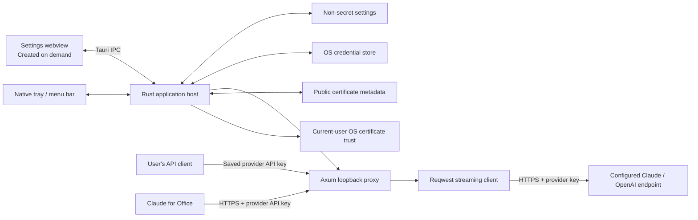

# llm_proxy Architecture

Status: MVP implemented; cross-platform release and memory gates pending

Date: November 15, 2026

Requirements: [REQUIREMENTS.md](REQUIREMENTS.md)

## 1. Recommended framework

Use **Tauri 2 + Rust for the desktop application and proxy, with Svelte + TypeScript for the settings GUI**.

Tauri uses the operating system's webview: WKWebView on macOS and WebView2 on Windows. Its Rust core and webview processes have separate responsibilities, and it supports native tray menus. This fits an application whose proxy runs continuously while its settings window opens occasionally. [S1, S2]

The key design decision is to **create the settings webview only when needed and destroy it when the window closes**. Automatic startup should create the Rust host, tray/menu bar control, and proxy without creating a settings window. Tauri supports deferred window creation and explicit window destruction. [S3, S4]

This is a recommendation based on the framework's architecture, not a measured RAM guarantee. Release builds must demonstrate background usage strictly below 200 MB across all app processes, ideally below 100 MB, on every supported architecture before the stack is accepted for release.

### Alternatives considered

| Option | Relevant tradeoff | Decision |
| --- | --- | --- |
| Tauri 2 + Rust | Uses the OS webview, provides Rust integration, and supports the required desktop lifecycle. Requires maintaining Rust and TypeScript code. [S1-S4] | Recommended; validate memory behavior first. |
| Wails + Go | Also combines a compiled backend with the OS webview. A reasonable alternative if Go becomes the team's preferred language. Its memory and lifecycle behavior would need the same validation. [S5] | Viable alternative; no evidence here that it uses less memory. |
| Electron + TypeScript | Bundles Chromium and Node.js. That adds a runtime distribution cost that is a weaker fit for this application's small installer and background resource priorities. [S6] | Do not select for the MVP. |

The implementation uses stable Tauri 2 with compatible plugins and committed Cargo/npm lockfiles. Rust is pinned in `rust-toolchain.toml`; dependency changes must preserve those locks.

## 2. Technology choices

| Layer | Proposed technology | Responsibility |
| --- | --- | --- |
| Desktop host | Tauri 2 / Rust | Application lifecycle, native menus, window creation, GUI commands. |
| Settings GUI | Svelte + TypeScript + Vite | Provider setup, connection tests, status, startup settings, diagnostics. |
| Local HTTP/HTTPS server | Axum routing + Hyper transport; Tokio Rustls for inbound TLS | Shared routing/authentication, bounded HTTP/1.1 and HTTP/2 connections, incremental streams. |
| Local certificate generation | rcgen with Ring | Unique per-installation P-256 CA/server identity; loopback-only SANs and CA name constraints. |
| Certificate trust | Platform adapter + Rustls/native root verification | Explicit current-user trust, status checks, renewal/removal through the GUI. |
| Async execution | Tauri's Tokio runtime | Network tasks, cancellation, bounded background work. |
| Upstream HTTP client | Reqwest with Rustls | TLS, connection reuse, request and response streaming. |
| Credential storage | `keyring-core` with native platform stores | macOS Keychain and Windows Credential Manager. |
| Non-secret settings | Serde + versioned JSON files | Endpoints, HTTP/HTTPS ports, preferences; public certificate chain and expiration stored separately. |
| Operational diagnostics | Bounded, sanitized in-memory ring | Up to 64 lifecycle and error events; no request content or disk logs. |
| Startup integration | Tauri autostart plugin behind a Rust interface | User-controlled launch at login. |
| Instance control | Tauri single-instance plugin | One host per user session; reopen settings in the existing host. |

Svelte compiles UI components into JavaScript; use a small static frontend without a separate production web server. Axum is built around Tokio/Hyper and Tower middleware. Reqwest exposes streamed response bodies and configurable network policies. [S7-S9]

The credential implementation should depend on `keyring-core` and only the Apple/Windows native stores required by the build. The current keyring project recommends selecting stores explicitly instead of pulling in its general-purpose CLI dependencies. Never use its sample or mock store in production. [S10]

Node.js and npm are build tools for developers and CI. End users install a packaged application and do not install a JavaScript runtime, Rust toolchain, or CLI.

## 3. Runtime and component boundaries



One application-owned Rust host runs the proxy, state management, and native desktop integration. The OS webview may create additional processes while settings are open. The proxy must operate independently of the settings window and its JavaScript lifecycle. [S1]

| Component | Owns |
| --- | --- |
| `AppController` | Start/stop sequencing, tray actions, shutdown, and authoritative application state. |
| `RunningProxy` | HTTP/HTTPS loopback listeners, bounded connections, authentication, shared request limits, routing, cancellation. |
| `ProviderRegistry` | Immutable configuration snapshots and per-provider HTTP clients. |
| `CredentialStore` | Store/read/delete provider keys and the HTTPS server private key; serialize native credential operations. |
| `CertificateStore` | Generate/validate a device identity, persist public certificates atomically, load the private key for serving, expose non-secret trust/expiration status. |
| Certificate platform adapter | Install/remove only this identity's public root in current-user trust; handle OS authorization failures. |
| `SettingsStore` | Validated configuration, schema migration, atomic writes. |
| `DesktopIntegration` | Startup registration, single-instance activation, window and tray lifecycle. |
| `Diagnostics` | Bounded logs and sanitized counters; no request/response content. |

Keep the proxy logic in a Rust library independent of Tauri. This allows integration tests and a different desktop shell if resource measurements require one.

## 4. GUI communication and state

The GUI calls a narrow set of typed Tauri commands, such as `get_status`, `save_provider`, `delete_provider`, `test_connection`, `start_proxy`, `stop_proxy`, and `set_start_at_login`. Rust validates all inputs and emits status-change events. Do not poll continuously or publish prompts and streamed response chunks into the UI.

HTTPS adds `set_https_port`, `setup_https`, `trust_https_certificate`, `check_https_trust`, and `remove_https`. Only the settings window is authorized. IPC carries no certificate private key and accepts no shell commands, certificate paths, trust-store names, or arbitrary certificates. Status includes whether HTTPS is enabled, its port, certificate configuration/trust, expiration, SHA-256 root fingerprint, and each provider's optional HTTPS base URL. Certificate setup/renewal, removal, and port changes require a stopped proxy. Trust changes are deliberate GUI actions with confirmation; the native OS may show its own authorization dialog. No new shell or filesystem permission is exposed to the webview.

Provider keys entered in the GUI move directly through IPC to the credential store. Ordinary settings/status responses contain only a `has_key` flag. Revealing or copying a stored secret requires a deliberate user action; clear transient secret fields when the view closes. Never persist secrets in webview storage.

Load only bundled UI assets, prevent navigation to remote content, apply a restrictive content security policy, and grant capabilities only to the settings window. Do not expose generic shell execution or arbitrary filesystem access. Tauri's capability system is the basis for constraining IPC/plugin access; custom commands must also validate inputs and authorization. [S11]

Track the server lifecycle separately from provider readiness: the server can be running while a provider is unconfigured, has a locked credential, or last failed a connection test. Provider errors must not take the other provider offline.

## 5. Local API contract and forwarding

### Addresses and supported surfaces

Use HTTP port **8787**, editable in the GUI, plus optional HTTPS port **8788**. Both bind explicitly to `127.0.0.1` and, where available, `::1`. HTTP URLs use `127.0.0.1`; HTTPS URLs use `localhost`, which is covered by the certificate along with both loopback IPs. Never bind a wildcard interface or silently choose another port. HTTPS uses a separate port so existing HTTP clients keep working without protocol sniffing, redirects, or URL changes. Both active ports must be distinct and must be excluded as upstream destinations.

Use separate provider namespaces. These examples specify the intended mapping, including the version prefix:

| Provider | Saved upstream base | Local client base | Example forwarding |
| --- | --- | --- | --- |
| OpenAI | `https://api.servicesessentials.ibm.com/v1` | `http://127.0.0.1:8787/openai/v1` | `/openai/v1/responses` becomes upstream `/v1/responses`. |
| Claude | `https://api.servicesessentials.ibm.com` | `http://127.0.0.1:8787/claude` | `/claude/v1/messages` becomes upstream `/v1/messages`. |

Once HTTPS has been set up, Office uses `https://localhost:8788/claude`; OpenAI-compatible browser clients can use `https://localhost:8788/openai/v1`. Both transports share the same namespaces, upstream snapshots, provider-key authentication, CORS policy, eight-request concurrency limit, and cancellation token. There is no separate HTTPS token. The local listeners do not redirect between HTTP and HTTPS.

### Local HTTPS identity and user trust

Anthropic's Office gateway configuration calls for an HTTPS base URL and CORS for the Office origin. The app terminates TLS itself, with no reverse-proxy process, Node runtime, external certificate-generation utility, hosted relay, or development-tool prerequisite for end users. TLS 1.2/1.3 and ALPN for HTTP/1.1 and HTTP/2 use Rustls with the existing Ring provider. The settings GUI supplies the complete setup flow. [S19-S21]

1. **Set up HTTPS:** while stopped, generate a unique P-256 root and server key. The root has a path-length limit of zero and name constraints for `localhost`, `127.0.0.1/32`, and `::1/128`. The leaf has exactly those three SANs, digital-signature key usage, and server-authentication extended key usage. Backdate validity five minutes for small clock differences; the server certificate lasts 365 days and the root 3650 days.
2. **Persist the identity:** save only the public root/leaf DER and expiration in `https-identity.json`. Save the server's PKCS#8 DER key as the `https-server-key` credential through the native store; never put it in settings, temporary files, IPC, logs, or the repository. The issuing private key is discarded after the one server certificate is signed. Owned exported key buffers use `Zeroizing`; libraries/OS internals can retain transient copies. Each device generates its own identity; sharing the developer Rust bundle does not share certificates or credentials.
3. **Trust certificate:** after GUI confirmation, add the public root to this user's OS trust. On macOS, invoke `/usr/bin/security` directly with argument arrays: discover the user's default keychain and add SSL trust in the user domain, with no `sudo`, shell, or admin-domain flag. On Windows, use Crypt32 to add the certificate to the current user's `ROOT` store. These operations may require OS authorization or be blocked by management policy. Do not bypass a denial or disable client certificate validation. [S23, S24]
4. **Verify and connect:** validate the chain, SAN, lifetime, and private-key match; evaluate trust against native-loaded roots. Trust status is refreshed at launch and on explicit checks/actions, with no background polling. This verifies the local chain, not Office connectivity or its browser permissions. Restart Office after trust changes, start the proxy, and copy the HTTPS URL. The existing HTTP URLs remain available. [S22]
5. **Renew or remove:** renewal is explicit while stopped and replaces both root and leaf, removing the old root's trust. Because the issuing key is discarded, renewal needs a new trust approval; the GUI shows the expiry and does not silently renew roots or prompt during login. Remove HTTPS deletes this root's trust/certificate by exact identity, deletes its private key/public metadata, and disables HTTPS. Reset/pre-uninstall performs the same cleanup before clearing provider keys and settings. Do not delete unrelated roots. If cleanup is denied, retain an actionable failure and allow retry.

Setup is opt-in for existing and new installations, because certificate trust requires a deliberate user decision. Older settings default `httpsEnabled` to false and `httpsPort` to 8788, preserving saved HTTP endpoints, keys, startup preferences, and browser-origin policy. If an existing HTTP client already uses port 8788, require a different HTTPS port when enabling it; do not invalidate the previous HTTP-only configuration.

Construct and validate the identity and bind every enabled loopback listener before spawning serving tasks. A TLS key/chain/expiry problem or any enabled-port conflict fails startup and releases all new bindings; do not silently downgrade a configured HTTPS listener. Starting at login reuses the saved certificate and private key without a webview, trust prompt, or network dependency. A locked key store or expired/missing identity requires attention in settings. Public metadata is written atomically; on a failed write, restore the previous server key, reporting a rollback failure explicitly if necessary. Removing prior trust during renewal can require re-trusting the previous identity after a failed replacement.

The native trust operation and an actual Office session still need platform acceptance tests. An HTTPS listener does not guarantee access through every Office build, local-network permission, enterprise certificate policy, or future Office origin. Preserve the editable exact-origin allowlist and document additional origins only when Anthropic publishes them.

Treat the saved upstream URL as a base, with provider-specific conventions explained in the GUI. Strip the complete local mount prefix and append the remaining relative path to the saved base, preserving its path and the incoming query string. For example, an OpenAI base ending in `/gateway/v1` must remain `/gateway/v1/responses`. Show a destination preview during setup; never guess by repeatedly adding/removing `/v1`.

Validate base URLs, reject embedded credentials and fragments, and prevent absolute request targets or path traversal from changing the configured destination. A client cannot choose a new upstream host through a URL, query parameter, or header. Reject configurations that route back into this app's own listeners.

Require certificate-validated HTTPS for remote upstreams. Permit HTTP only for explicitly configured loopback addresses; any hostname exception must remain loopback at connection time, not just during setup validation. Expose no configuration/administration HTTP endpoints and reject unsupported proxy methods such as `CONNECT`. GUI administration uses Tauri IPC.

Browser access defaults to the exact Office origin `https://pivot.claude.ai`. `BrowserOrigins` in `crates/proxy-core/src/cors.rs` validates up to 16 unique canonical HTTPS origins without paths, credentials, or wildcards. Users can edit the list in settings while stopped; an empty list disables browser access. Persist it as non-secret configuration, default older settings files to the Office origin, and preserve an explicitly empty list. Each running proxy keeps an immutable policy snapshot. Validate a single Origin header, loopback Host, namespace, header budget, and GET/POST/OPTIONS methods. Valid OPTIONS preflights return 204 without authentication, provider configuration, upstream traffic, or generation capacity. Echo validated requested header names so SDK metadata additions do not require app updates; explicitly listing Authorization avoids wildcard-header semantics. Actual API calls still authenticate against the saved provider key. Add local CORS headers to successes and all errors for an approved origin, preserve Vary, and expose returned header names for request IDs and rate-limit metadata. Strip browser Origin/Referer and CORS request headers before forwarding; discard all upstream CORS policy headers. Cookie-based browser credentials are not enabled. Unlisted origins remain rejected, including other Claude subdomains by default. Native clients without Origin retain their existing API behavior.

This CORS policy applies equally to HTTP and HTTPS. Users can add future documented origins through the GUI without a release. Broad subdomain trust would not cover a move to a different domain, path/protocol changes, or browser transport restrictions. A real Office smoke test remains required before claiming end-to-end Office support.

Proposed compatibility coverage is Claude Messages and model listing, plus OpenAI Responses, Chat Completions, and model listing over HTTP, including applicable SSE streams. Other ordinary HTTP routes can pass through the same forwarding machinery but are unverified until added to the compatibility matrix. WebSockets, Realtime sessions, and large-file transfer support require separate scope decisions.

### Request pipeline

1. Validate browser origin, local Host, namespace, and header limits. Answer approved browser preflights locally; enforce actual-request concurrency before forwarding bodies.
2. Select the provider from the namespace and snapshot its configuration and credentials for this request.
3. Validate the client's credential against the API key in that provider snapshot.
4. Construct the destination under the configured upstream base.
5. Remove local credentials, unrelated provider credentials, hop-by-hop headers, and the incoming `Host`; set the correct upstream authentication.
6. Stream the body to the upstream and relay its status, relevant headers, and response body with bounded buffering.
7. Release the concurrency permit and upstream resources when the response finishes, the client disconnects, or cancellation occurs.

Use the same API key saved by the user for both local authentication and the selected provider's upstream authentication. Do not generate a separate local token. Accept the key as a Bearer token or in `x-api-key`, validate it against the selected provider snapshot, and reject missing, incorrect, duplicate, or conflicting credentials. A key saved only for Claude cannot authenticate to the OpenAI namespace, and vice versa. Key rotation atomically changes authentication and forwarding for new requests; existing streams retain their original snapshot.

OpenAI uses Bearer authentication. Claude supports Bearer credentials and an `x-api-key` compatibility mechanism, as documented by the providers. The Claude adapter should initially inject the saved key through `x-api-key` and remove any client Bearer credential. Preserve applicable version, beta, workspace, project, and organization metadata without confusing it with local authentication; workspace/project overrides can live in advanced settings when needed. [S12, S13]

Keep payloads and model identifiers opaque: no provider SDK, JSON rewriting, model list, or API translation is required in the forwarding path. Filter hop-by-hop headers in both directions, including headers named by `Connection`. Let the HTTP transport regenerate framing headers when needed.

Host validation is specific to the accepting listener's port. HTTP/1 absolute-form request targets remain forbidden. HTTP/2 uses its normal `:authority` value and rejects a conflicting Host header; accepting HTTP/2 must not create an alternate destination-selection path.

Strip upstream `Strict-Transport-Security` and `Alt-Svc` along with existing cookie/framing/CORS filters. Remote transport policy must not configure the localhost origin or advertise a remote HTTP/3 endpoint for this listener.

### Streaming and error handling

- Relay response bytes as they arrive; preserve SSE content types and event data. Do not parse and rebuild events.
- Use bounded backpressure between downstream and upstream. Avoid whole-body `.json()`, `.text()`, or `.bytes()` calls in the forwarding path.
- Configure compression explicitly so bytes and `Content-Encoding` remain consistent. Prefer opaque pass-through without automatic decompression.
- Disable redirects, cookies, and automatic request retries. Explicitly audit Reqwest's retry policy instead of assuming the client has no retries. [S8, S9]
- Proposed timeouts: 10 seconds to connect, 120 seconds to receive response headers, and 120 seconds without body progress. Do not apply a short fixed total timeout to an active stream. Tune these against real client behavior.
- Preserve upstream error status, safe headers, and body. For errors generated locally, use a small provider-shaped JSON error with a stable code and actionable message.
- Once response headers have been sent, an interrupted stream cannot become a different HTTP status. Close the stream, cancel upstream work, and record sanitized diagnostics.

## 6. Settings and credential persistence

Store non-secret JSON in the current user's platform application-data directory. Include `schema_version`, local port, startup preference, provider base URLs, optional provider metadata, and stable credential identifiers. Do not introduce a database for this small configuration surface.

The serialized settings use camelCase and add `httpsEnabled`/`httpsPort` with backward-compatible defaults. `https-identity.json` is a separate versioned, size-limited public-certificate document. Validate its chain, loopback names, and expiration cryptographically before activating it; validate the key match when loading from the native store. Do not infer trust solely from a saved boolean or successful file creation.

Write through a temporary file and atomic replacement. Validate and migrate before activation; preserve the last working configuration if a save fails. Apply new provider snapshots to new requests, allowing in-flight requests to finish on their existing snapshot. Port changes require a controlled listener restart and a clear GUI status.

Store provider keys under stable application-specific names in macOS Keychain or Windows Credential Manager through the native adapters. Credential-store calls that can block must run outside async networking tasks. Locked or denied stores produce an actionable state with no plaintext fallback. Reset also removes any obsolete local-token credential left by earlier builds. [S10]

Keep secrets out of URLs, process arguments, environment variables, config backups, and logs. Minimize in-memory copies and zeroize owned secret buffers where practical; this does not guarantee removal of every transient copy made by an OS or networking library. Deleting a provider configuration removes its credential as well.

## 7. Automatic startup and desktop lifecycle

Automatic startup means **launch at user sign-in after reboot**. A service running before login is outside this per-user desktop design.

Use the Tauri autostart plugin through `DesktopIntegration`, with a macOS LaunchAgent and the plugin's Windows per-user integration. Register a background-launch argument internally; users never need to enter it. Read the effective OS registration when displaying the setting, and handle registration failures or OS-disabled startup visibly. [S14]

Configure the plugin's `macos_launcher` builder method only in macOS builds. The shared builder supplies `--background` on every supported platform; Windows uses the plugin's native startup implementation without calling the macOS-only API.

Enable startup by default for new installations. Distinguish a missing settings file from saved settings: on first launch, register the default through the same save/rollback path as the GUI toggle. On subsequent launches, preserve saved preferences and read the effective OS registration without re-enabling startup. Resetting data for uninstall explicitly saves startup as disabled.

| Event | Required behavior |
| --- | --- |
| First manual launch | Create the host and settings window; keep proxy stopped until setup is complete. |
| Automatic launch | Create host and tray only; load saved settings and start configured providers without a webview. |
| Open settings / launch app again | Reuse the existing host and create or focus one settings window. |
| Close settings | Destroy the settings window and detach its subscriptions; leave proxy and tray running. |
| Stop proxy | Close listeners, stop admitting requests, and cancel/drain in-flight work within a five-second shutdown budget. Keep tray/settings available. |
| Quit | Stop the proxy, release credentials and resources, remove tray controls, and exit. Do not restart in the same session. |
| Disable startup | Remove OS startup registration; do not silently stop an already running proxy. |

Use the single-instance plugin to route manual reactivation to the existing app before starting listeners. Do not register a keep-alive/watchdog policy that immediately restarts the app after explicit quit. [S15]

At automatic startup, defer credential access until it is available and report blocked startup through the tray. Use bounded, event-driven or backoff recovery rather than repeated prompts or busy polling. Missing internet access must not prevent local listener startup.

## 8. Memory and background resource design

**Required:** peak combined background RAM strictly below 200 MB. **Ideal:** below 100 MB. These include the host and every app-associated helper/webview process, even if a helper outlives the settings window.

- Start without constructing a webview; create one only to show settings.
- Destroy closed settings windows instead of merely hiding them. Whether helper processes and allocations are actually reclaimed is a measurement question, not an assumption.
- Use one Tokio runtime, a modest worker count, bounded tasks, and reused HTTP clients with small connection pools.
- HTTP and HTTPS share a hard limit of 64 accepted connections, including incomplete TLS handshakes. Use tracked connection tasks; reject excess connections promptly. TLS handshakes have a five-second timeout, HTTP/1 headers a ten-second read timeout and 32 KiB buffer budget, and HTTP/2 limits of eight concurrent streams per connection, 32 KiB header lists, and a 64 KiB send buffer. The existing global eight-request forwarding budget applies across transports. Cancel listeners, incomplete handshakes, connections, and upstream bodies together on stop/drop.
- Stream uploads and downloads without complete request/response buffering. Proposed initial limits are 8 active forwarded requests, 32 KiB of request headers, and a 32 MiB request body limit enforced incrementally. Reject excess work promptly instead of building an unbounded queue.
- Bound individual transport queues and tune HTTP/2 flow-control buffers and connection pools against the measured budget. A body size limit alone does not bound process memory.
- Keep diagnostics in a small fixed in-memory ring. The MVP stores no disk logs and records only sanitized lifecycle/error messages; omit full URLs and content. Any future disk log must be capped at 5 MiB total.
- Disable production developer tooling and avoid periodic model discovery, background connection tests, or UI polling.

The hard cap applies to the idle and representative forwarding workloads defined by the requirements. Measure open-window memory separately and check that closing the window returns to a stable background level.

If the single-host design cannot meet the cap after settings have opened and closed, separate the settings GUI into an on-demand process that exits completely, leaving a small Rust proxy/tray host. That fallback needs a permission-restricted local IPC channel and its own lifecycle review. Make this decision during the initial prototype, before building the full GUI; do not relax the RAM requirement to accommodate the framework.

## 9. Installation and distribution

| Target | Proposed artifact | Release checks |
| --- | --- | --- |
| Intel Mac | Signed and notarized x86_64 `.app` in `.dmg` | Native run, setup, credential access, startup, streaming. |
| Apple Silicon Mac | Signed and notarized arm64 `.app` in `.dmg` | Native run without Rosetta; same functional checks. |
| Windows x64 | Signed NSIS setup `.exe`, per-user installation | Clean install, runtime handling, startup, uninstall. |

Use separate, clearly labeled macOS architecture downloads initially to simplify the per-download size budget. A universal application is optional later. Tauri provides macOS bundling and Windows NSIS/MSI packaging; its default per-user NSIS mode avoids requiring administrator privileges for the application installation. [S16, S17]

On Windows, use Evergreen WebView2 and automatically install it through the GUI installer if missing. Prefer an embedded bootstrapper over bundling a fixed browser runtime. Microsoft and Tauri document online bootstrapper and larger offline installer options. [S17, S18]

The proposed 75 MB download target covers the primary app installer. Record any additional runtime download and total installed size separately; a fully offline Windows installer containing WebView2 may exceed that target and is not the primary MVP artifact. After dependencies are installed, setup and local server startup must work offline.

Provide graphical removal of credentials, settings, and startup registration. Windows uninstall hooks must remove startup registration and offer data removal. On macOS, provide a **Prepare to Uninstall** action that removes credentials/data and disables startup before the user removes the application in Finder. Handle upgrades without duplicating startup registrations or losing credential identifiers.

Use the in-app reset/pre-uninstall action before deleting the application to remove its local HTTPS root trust and server private key. Deleting application files alone cannot be assumed to remove OS trust or credential entries. Public release acceptance must include trust install/cancel/deny, renewal, reboot reuse, and certificate removal for the current user on both operating systems.

Build release artifacts on macOS and Windows CI runners, pin toolchains and dependency lockfiles, and sign only in protected release jobs. Test Intel and Apple Silicon builds on their respective architectures. The MVP can use manually downloaded signed updates; automatic updating is a later decision.

## 10. Repository layout

```text
llm_proxy/
  REQUIREMENTS.md
  ARCHITECTURE.md
  CODING_STYLE.md
  README.md
  src/                       # Svelte settings UI and typed IPC client
  src-tauri/
    src/
      app.rs                 # Controller and lifecycle
      commands.rs            # GUI command boundary
      desktop.rs             # Tray, native menus, on-demand windows
      credentials.rs         # Native store adapter
      certificates.rs        # Device identity, public metadata, trust status
      certificates/platform.rs # User-scoped native trust install/removal
      settings.rs            # JSON validation, persistence, migration
    capabilities/            # Restricted settings-window permissions
    tauri.conf.json
  crates/proxy-core/
    src/                     # Routing, streaming, auth, provider adapters, Rustls identity
    tests/                   # Deterministic loopback upstream fixtures
  postman/                   # Local native-provider transport simulation
  scripts/                   # Simulation verification and repository-local Rust wrapper
  .toolchains/rust/          # Optional host-specific Rust/Cargo installation; Git-ignored
  .github/workflows/         # Verify and package unsigned test builds
```

The core is implemented separately from Tauri. See `README.md` for developer commands and `VALIDATION.md` for completed checks and outstanding release gates.

### Developer toolchain portability

The temporary Apple Silicon toolchain has been moved into `.toolchains/rust/{cargo,rustup}`. `scripts/with-rust.mjs` derives these paths from its own repository location, configures child-process-only `PATH`, `CARGO_HOME`, `RUSTUP_HOME`, and `RUSTUP_TOOLCHAIN`, and verifies that the compiler host/version match `rust-toolchain.toml`. `npm run tauri` and `npm run cargo` use it automatically. Without the bundle, they use system Rust, including in CI; an incomplete or wrong-host bundle produces an actionable error.

Share this large binary/cache bundle separately from Git, preserving hidden files, executable bits, and symlinks. The current installation is Apple Silicon macOS-specific: Intel Macs and Windows require separate matching host installations and their native Tauri build prerequisites. Cargo's cached dependencies do not guarantee an offline build. Node, Rust, and the toolchain bundle are development inputs and are not added to end-user installers. [S25]

## 11. Validation and implementation sequence

1. **Resource prototype:** build a release-mode tray host with an on-demand settings window, credential access, autostart, and one streamed request path. Measure all three required architectures before expanding the UI.
2. **Proxy core:** verify authentication replacement, URL/base-path handling, safe headers, streaming, cancellation, error preservation, concurrency limits, and shutdown against deterministic local upstream fixtures. No paid API is needed for these checks.
3. **GUI and lifecycle:** implement provider setup, connection tests, credential handling, port conflicts, tray controls, and first/manual/automatic launch behavior. Use a non-generation authenticated request for connection tests where supported; otherwise explain possible billing before testing.
4. **Compatibility:** validate the agreed Claude/OpenAI client scenarios, including streaming, against controlled fixtures. Then perform explicitly configured live smoke checks without recording real secrets or message content.
   HTTPS fixtures must check CA/hostname verification without insecure TLS overrides, untrusted-certificate rejection, approved/denied origins, unauthenticated preflights, provider-key authentication, HTTP/2 authority handling, early SSE delivery, capacity shared with HTTP, client cancellation, incomplete-handshake shutdown, port-conflict rollback, and self-proxy rejection on both ports. Certificate tests generate unique identities, reject expired/corrupt/mismatched material, preserve old HTTP-only settings, and avoid changing the test machine's OS trust or credentials. Native trust and Office behavior remain separate manual platform gates.
5. **Release:** verify signed installers on clean user accounts, missing-runtime handling, reboot/sign-in startup, disable-startup, quit, upgrade, and uninstall.

For the initial memory gate, settle for 60 seconds, sample the combined process-tree memory once per second for 10 minutes idle, then 10 minutes with 8 simultaneous SSE connections against a local upstream emitting fixed 1 KiB events once per second. Repeat after 20 settings open/close cycles. Add a large-body and slow-client run to catch buffering growth. Record machines, OS/runtime versions, executable versions, payloads, throughput, CPU, and peak memory.

Use consistent process attribution: resident memory on macOS and resident working set on Windows, summing app-associated processes and documenting any shared-page double counting. Also record private memory for diagnosis. The measurement tooling must include OS-hosted webview helpers rather than relying only on the Rust host's PID. Report these as platform-specific measurements, not interchangeable memory accounting systems.

Reject release if any required background workload reaches 200 MB. Report the under-100-MB target separately. Verify forwarding overhead with a separate controlled local upstream benchmark so network and provider generation latency do not hide proxy costs.

Local verification is tracked in `VALIDATION.md`. A passing build or a host-process memory sample does not satisfy the combined-process resource gate above. No live provider requests have been made during implementation.

## 12. Decisions still open

- Reference hardware for macOS 13+ (Intel and Apple Silicon) and Windows 11 x64.
- Signed release identity, notarization, and clean-machine installer acceptance.
- Final client compatibility matrix and treatment of optional API surfaces.
- Final workload/limit tuning, long-stream timeout behavior, and advanced provider metadata controls.
- Whether measured webview resource retention requires the separate GUI-process fallback.
- Whether a fully offline Windows installer or automatic updater should follow the MVP.

The framework, default port, limits, and packaging are implemented as described in `README.md`. `REQUIREMENTS.md` remains the source of product requirements, including the mandatory memory cap.

## 13. Primary references

Framework and library documentation was reviewed on November 15, 2026. Source labels identify external capabilities; limits and design choices in this document are project proposals.

- S1 — Tauri process model: `https://v2.tauri.app/concept/process-model/`
- S2 — Tauri system tray: `https://v2.tauri.app/learn/system-tray/`
- S3 — Tauri window configuration (`create`): `https://v2.tauri.app/reference/config/`
- S4 — Tauri window lifecycle (`destroy`): `https://docs.rs/tauri/2/tauri/webview/struct.WebviewWindow.html`
- S5 — Wails architecture and supported platforms: `https://v3.wails.io/faq/`
- S6 — Electron runtime architecture: `https://www.electronjs.org/docs/latest/why-electron`
- S7 — Svelte overview: `https://svelte.dev/docs/svelte/overview`
- S8 — Reqwest client policies: `https://docs.rs/reqwest/latest/reqwest/struct.ClientBuilder.html`
- S9 — Axum and streaming response interfaces: `https://docs.rs/axum/latest/axum/`; `https://docs.rs/reqwest/latest/reqwest/struct.Response.html`
- S10 — Keyring store selection and native adapters: `https://github.com/open-source-cooperative/keyring-rs`; `https://docs.rs/apple-native-keyring-store/latest/apple_native_keyring_store/`; `https://docs.rs/windows-native-keyring-store/latest/windows_native_keyring_store/`
- S11 — Tauri capabilities: `https://v2.tauri.app/security/capabilities/`
- S12 — OpenAI authentication: `https://developers.openai.com/api/reference/overview/`
- S13 — Claude endpoints and authentication: `https://platform.claude.com/docs/en/api/overview`
- S14 — Tauri autostart integration: `https://v2.tauri.app/plugin/autostart/`
- S15 — Tauri single-instance integration: `https://v2.tauri.app/plugin/single-instance/`
- S16 — Tauri macOS application bundles: `https://v2.tauri.app/distribute/macos-application-bundle/`
- S17 — Tauri Windows installation and WebView2 modes: `https://v2.tauri.app/distribute/windows-installer/`
- S18 — Microsoft WebView2 distribution: `https://learn.microsoft.com/microsoft-edge/webview2/concepts/distribution`
- S19 — Anthropic Office gateway setup: `https://claude.com/docs/office-agents/third-party-platforms`
- S20 — rcgen certificate parameters and signing: `https://docs.rs/rcgen/0.14.10/rcgen/`
- S21 — Rustls server configuration: `https://docs.rs/rustls/0.23/rustls/struct.ServerConfig.html`
- S22 — Native certificate loading: `https://docs.rs/rustls-native-certs/0.8/rustls_native_certs/`
- S23 — Apple security tool user trust/authorization: `https://github.com/apple-oss-distributions/Security/blob/main/SecurityTool/macOS/security.1`
- S24 — Windows certificate stores and Crypt32: `https://learn.microsoft.com/windows/win32/seccrypto/system-store-locations`; `https://learn.microsoft.com/windows/win32/api/wincrypt/nf-wincrypt-certopensystemstorew`
- S25 — Rustup environment and host toolchains: `https://rust-lang.github.io/rustup/environment-variables.html`
